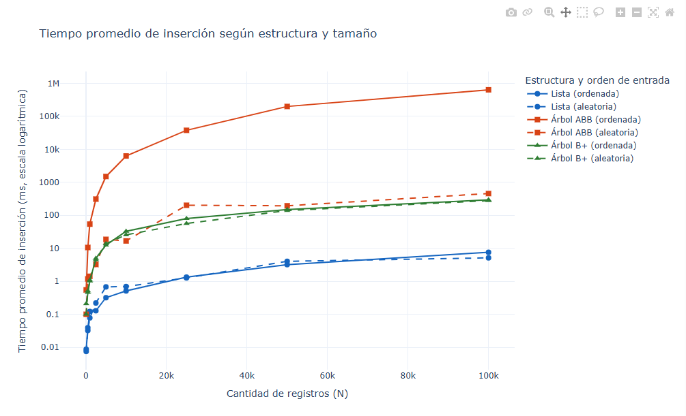
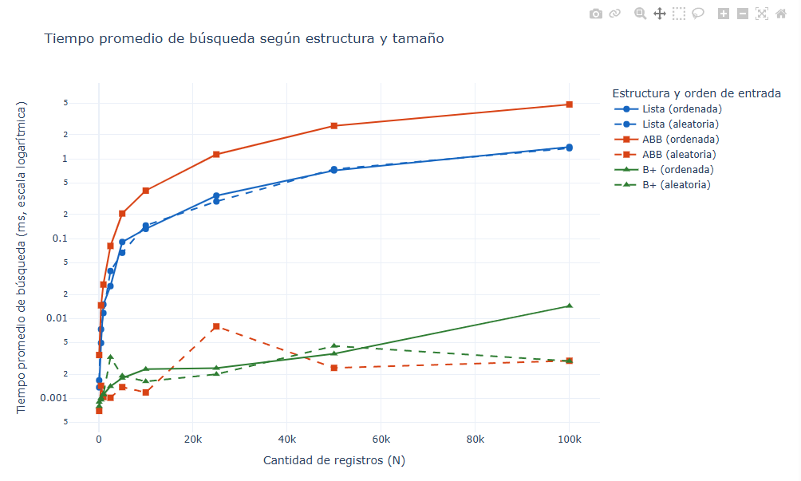

# Sistema de búsqueda de estudiantes

Proyecto académico para implementar y comparar tres estructuras de datos por ID: una lista, un Árbol Binario de Búsqueda (ABB) y un árbol B+. Los resultados se miden en milisegundos y se analizan con estadísticas y gráficas interactivas.

## Archivos Python

- `lista_estudiantes.py`: define `Estudiante` y `ListaEstudiantes`. Inserta al final de una lista, busca linealmente por ID y puede devolver los estudiantes ordenados. Al ejecutarlo directamente, crea 10,000 registros y mide inserción y 100 búsquedas para los órdenes ordenado y aleatorio. Escribe `tiempos_lista_ordenado.csv` y `tiempos_lista_aleatorio.csv`.
- `abb_estudiantes.py`: define los nodos y la clase `ArbolBinarioBusqueda`. Inserta y busca iterativamente, y lista mediante recorrido inorden. Al ejecutarlo directamente realiza la prueba autónoma de 10,000 registros y escribe dos CSV `tiempos_abb_*.csv`.
- `arbol_bmas.py`: implementa el árbol B+ con búsqueda binaria manual en sus nodos, divisiones de hojas/nodos internos y hojas enlazadas. También ofrece la prueba autónoma de 10,000 registros y escribe dos CSV `tiempos_bmas_*.csv`.
- `escalabilidad_estudiantes.py`: es el runner principal de escalabilidad. Genera datos ordenados o aleatorios, evalúa cada estructura en secuencia, mide inserción y 100 búsquedas, y produce los seis archivos `busquedas_*.csv`. La constante `TAMANOS` contiene actualmente `100`, `500`, `1,000`, `2,500`, `5,000`, `10,000`, `25,000`, `50,000` y `100,000`. Cada CSV tiene 900 filas de datos: 100 por cada tamaño.
- `analizar_rendimiento.py`: lee los seis CSV fila por fila, agrupa por tamaño y calcula media y desviación estándar muestral con acumuladores de memoria constante. Imprime el resumen y genera las gráficas interactivas de búsqueda e inserción.

## Flujo de ejecución

1. El runner abre los seis CSV en modo escritura y escribe sus encabezados. Por eso, cada nueva ejecución reemplaza los resultados anteriores.
2. Recorre las estructuras en el orden Lista, ABB y B+. Para cada tamaño ejecuta las condiciones ordenada y aleatoria.
3. `generar_dataset` produce estudiantes con IDs secuenciales o con una permutación determinista. El runner convierte ese generador en una lista antes de medir, de modo que la misma entrada se pueda usar en inserción y muestreo. La lista de entrada mantiene referencias a los estudiantes mientras los nodos de la estructura los organizan.
4. `medir_estructura` cronometra la inserción completa y cada una de las 100 búsquedas por separado con `time.perf_counter()`. Convierte segundos a milisegundos, verifica que se encuentren los IDs y libera la estructura en un bloque `finally`.
5. Las mediciones se agregan a los CSV de la condición y estructura correspondientes. Al terminar, el runner libera explícitamente la lista fuente; si ocurre un `RecursionError`, registra el escenario en `benchmark_errores.csv`, libera la entrada y continúa.
6. El analizador calcula las estadísticas y crea `grafico_rendimiento_interactivo.html` y `grafico_insercion_interactivo.html`. Los HTML incorporan Plotly y se pueden abrir directamente en un navegador, son graficas interactivas en las cuales se pueden hacer principalmente zoom y obtener información de cada uno de los puntos de las graficas al ubicar el cursor sobre ellos.

### Limitación de memoria y ABB

Los CSV guardan métricas, no los registros de estudiantes. Sin embargo, para buscar en una estructura en memoria, los registros del escenario deben permanecer disponibles hasta terminar las búsquedas. El runner conserva una lista de entrada durante el escenario y luego libera la estructura; no ejecuta los tres sistemas a la vez.

El ABB no está balanceado. Con IDs insertados en orden se convierte en una cadena degenerada; sus métodos son iterativos para evitar desbordar la pila, pero la inserción puede crecer cuadráticamente. El árbol B+ mantiene su altura balanceada mediante divisiones.

## Requisitos y comandos

Instala la dependencia de visualización en el entorno de Python:

```powershell
python -m pip install -r requirements.txt
```

Ejecuta el benchmark principal:

```powershell
python escalabilidad_estudiantes.py
```

Analiza los CSV y crea los dos reportes HTML:

```powershell
python analizar_rendimiento.py
```

Para usar otra carpeta de entrada o rutas de salida:

```powershell
python analizar_rendimiento.py --csv-dir ruta/a/csv --salida ruta/busqueda.html --salida-insercion ruta/insercion.html
```

Las gráficas usan escala logarítmica en Y. La media es la altura de cada punto; la desviación estándar se imprime en consola, no se representa como puntos adicionales.

## Archivos de resultados

Cada CSV de búsqueda tiene las columnas `Tamano_N`, `Tiempo_Insercion_Global_ms`, `ID_Buscado` y `Tiempo_Busqueda_ms`. El tiempo de inserción se repite en las 100 filas de búsqueda del mismo escenario para que cada observación conserve el contexto del experimento.

Los seis nombres son `busquedas_ordenadas_lista.csv`, `busquedas_aleatorias_lista.csv`, `busquedas_ordenadas_abb.csv`, `busquedas_aleatorias_abb.csv`, `busquedas_ordenadas_bmas.csv` y `busquedas_aleatorias_bmas.csv`. `benchmark_errores.csv` registra errores de recursión; si solo contiene encabezados, no hubo fallos registrados en esa corrida.

Los archivos dentro de `.venv/` son el entorno virtual local. `__pycache__/` contiene bytecode generado por Python; ninguno de los dos forma parte del flujo funcional del experimento.

--------------------------------------------------------------------------------------------------

#  Análisis Experimental: Rendimiento de Estructuras de Datos (Lista vs. ABB vs. Árbol B+) 

Este documento presenta el análisis comparativo entre la **teoría de complejidad asintomática (Big-O)** y los **resultados empíricos** obtenidos al someter tres estructuras de datos diferentes a un sistema de búsqueda masiva de estudiantes (variando $N$ hasta 100,000 registros).

---
### Hardware: 

Los resultados obtenidos fueron tras ejecutar el programa en un equipo cuyo sistema opeativo es windows (v11), que cuenta con 16GB de RAM y un procesador intel 12th Gen (2.00 GHZ)

---

## 1. Análisis de Tiempos de Inserción (Construcción)

La gráfica de inserción:   mide el esfuerzo computacional requerido para poblar la estructura desde $N = 100$ hasta $100,000$ elementos. 
Se usaron estos valores, ya que la estructura del arbol ABB con registros ordenados tendía a desbordarse cada que se intentaba realizar el experimento con valores muy grandes, despues de varias experimentaciones y errores, se eligio como tope de 100.000 registros para asegurar que no haya ningún desbordamiento. 

Nota: El codigo está adecuado para reportar desbordamientos, por lo que si se desea repetir el experimento con valores N mucho mayores, y alguna estrcutura falla, se generará un reporte y las demás estructuras no se verán afectadas continuando su ejecución con normalidad.

* **Listas (Curvas Azules - $O(N)$):**
  * **Teoría:** Insertar elementos al final de un arreglo dinámico o lista enlazada tiene un costo lineal amortizado.
  * **Realidad vs. Explicación:** Las listas se posicionan como las más rápidas en la inserción. En lenguajes como Python, agregar un elemento al final (`append`) opera sobre bloques de memoria contigua altamente optimizados a nivel de hardware, incurriendo en un costo por nodo muy bajo en comparación con la creación masiva de objetos y punteros de los árboles.
* **Árbol ABB Ordenado (Curva Roja Sólida - $O(N^2)$):**
  * **Teoría:** Al insertar claves estrictamente ordenadas en un Árbol Binario de Búsqueda sin balanceo, el árbol degenera en una lista enlazada unidireccional, elevando el costo de inserción acumulado a cuadrático.
  * **Realidad vs. Explicación:** La gráfica muestra una **degradación catastrófica**, disparándose exponencialmente hacia arriba conforme crece $N$. Cada nueva inserción obliga al algoritmo a recorrer toda la profundidad actual del árbol (que equivale a $N$ pasos), validando de forma contundente la vulnerabilidad teórica de los ABB no balanceados ante entradas ordenadas.
* **Árbol B+ y ABB Aleatorio (Curvas Verdes y Roja Discontinua - $O(N \log N)$):**
  * **Teoría:** Las estructuras balanceadas o semialeatorias distribuyen las inserciones de manera equitativa, manteniendo una altura logarítmica.
  * **Realidad vs. Explicación:** Se mantienen estables en una franja intermedia muy controlada. Aunque implican mayor costo inicial que una lista debido a la reorganización de nodos y punteros, evitan por completo el colapso exponencial del ABB ordenado.

---

## 2. Análisis de Tiempos de Búsqueda

La gráfica de búsqueda: 
 evalúa el rendimiento al realizar consultas aleatorias de IDs dentro de las estructuras ya pobladas.

* **Árboles Eficientes - B+ y ABB Aleatorio (Curvas Inferiores en la Base - $O(\log N)$):**
  * **Teoría:** La búsqueda binaria o por bloques reduce el espacio de búsqueda a la mitad en cada nivel, logrando tiempos logarítmicos casi instantáneos.
  * **Realidad vs. Explicación:** Se mantienen en la parte más baja del gráfico (fracciones de milisegundo). Demuestran que, sin importar si $N$ crece, el número de saltos en memoria necesarios para encontrar un registro es sumamente bajo.
* **Listas y ABB Ordenado (Curvas Superiores - $O(N)$):**
  * **Teoría:** Una lista desordenada o un ABB degenerado exigen una búsqueda secuencial (lineal) recorriendo nodo por nodo en el peor de los casos.
  * **Realidad vs. Explicación:** Ambas estructuras sufren una degradación severa en el rendimiento de búsqueda. El ABB ordenado pierde por completo su ventaja jerárquica y rinde prácticamente igual de lento que una búsqueda lineal sobre una lista.

---

## 3. Conclusión: Teoría vs. Realidad

Los resultados empíricos confirman que **la teoría Big-O describe con gran precisión las tendencias límite de los algoritmos en la práctica**. Sin embargo, la realidad de ejecutar estos experimentos en un entorno de software real introduce matices importantes:

1. **El impacto del hardware y del entorno:** Pequeñas variaciones visuales respecto a las líneas geométricas perfectas de los libros de texto se deben al *overhead* (sobrecarga) del recolector de basura de Python, la gestión dinámica de objetos en RAM y los costos constantes de asignación de memoria.
2. **El costo de abstracción:** Las estructuras complejas (como los árboles) exigen un mayor costo computacional durante su **construcción/inserción**, pero compensan con creces este esfuerzo al garantizar tiempos de **búsqueda logarítmicos** inigualables a gran escala.

---

## Autoría, Créditos y Metodología (Vibecoding)

Este proyecto fue desarrollado bajo una metodología de **vibecoding** y co-creación asistida por Inteligencia Artificial, empleando un flujo de trabajo de doble modelo:

* **Gemini:** Utilizado como asistente de análisis para la fundamentación teórica, la interpretación de los resultados empíricos, la validación de complejidad asintótica y el diseño iterativo de los *prompts* técnicos.
* **Agente de Visual Studio (LLM GPT-6 Luna):** Utilizado como agente de desarrollo predeterminado para la implementación, generación de código en Python y estructuración de los scripts del proyecto a partir de las instrucciones diseñadas.


